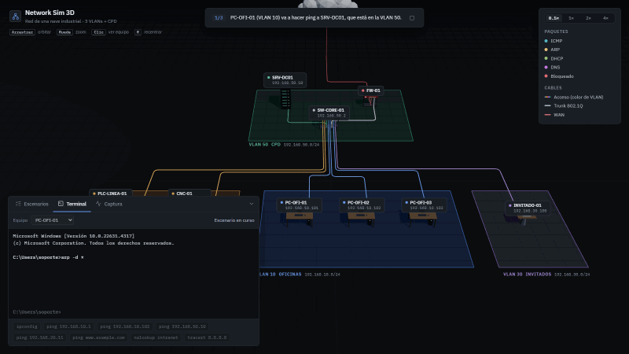
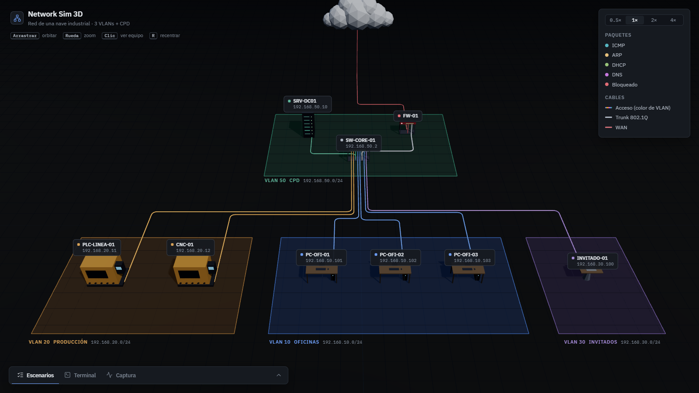
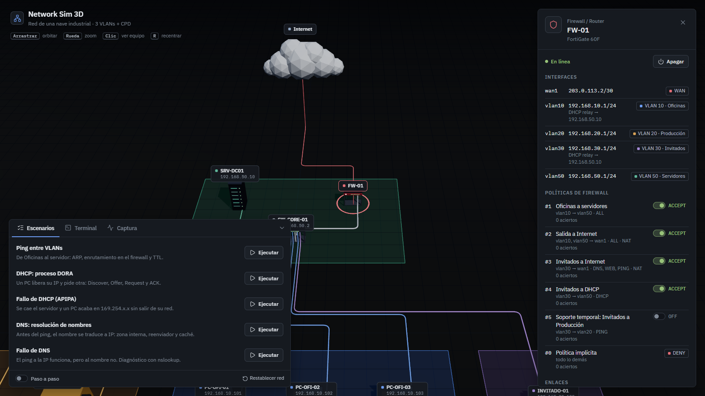
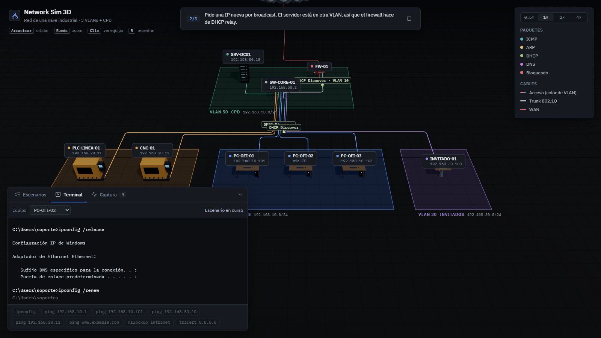
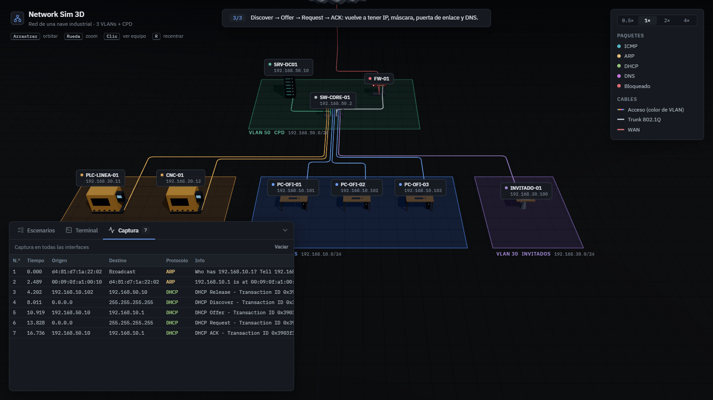
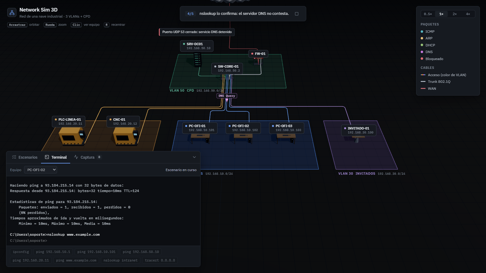
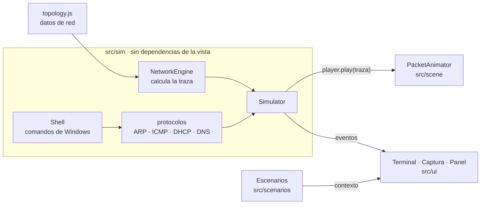

# Network Sim 3D

Simulador 3D de la red de una nave industrial. Los paquetes viajan salto a salto por los cables mientras una terminal con la salida real de Windows muestra lo que vería un técnico: ping, tracert, ipconfig, nslookup, DHCP, DNS, VLANs, firewall y averías.

[](https://github.com/rochydev/net-sim/actions/workflows/ci.yml)
[](https://github.com/rochydev/net-sim/actions/workflows/deploy.yml)

**Demo:** https://rochydev.github.io/net-sim/



## Qué es

Un proyecto para enseñar (y demostrar) cómo funciona una red de empresa por dentro, juntando las dos partes de mi perfil: sistemas y desarrollo. No es una animación pregrabada: un motor de red calcula qué le pasa a cada trama en cada equipo, y la escena 3D solo reproduce ese resultado.

- **Red realista:** switch con VLANs y trunk 802.1Q, router-on-a-stick, firewall con estado y NAT al estilo FortiGate, controlador de dominio con DHCP y DNS, Internet con los routers del ISP.
- **Terminal de Windows en castellano:** misma salida que `cmd.exe`, incluidas sus peculiaridades (`tiempo<1m`, "Host de destino inaccesible" que cuenta como recibido, `medios desconectados`...).
- **Captura de paquetes** tipo Wireshark con todas las tramas que circulan.
- **Escenarios guiados** con subtítulos, ejecutables de golpe o paso a paso.
- **Averías:** desconectar cables y apagar equipos desde el panel para ver el impacto.

## Capturas

| Vista general                                           | Firewall: interfaces y políticas             |
| ------------------------------------------------------- | -------------------------------------------- |
|  |  |

| DHCP a través del relay              | Captura de paquetes                          |
| ------------------------------------ | -------------------------------------------- |
|  |  |



## Escenarios

| Escenario                      | Qué se ve                                                                                                                                                                                        |
| ------------------------------ | ------------------------------------------------------------------------------------------------------------------------------------------------------------------------------------------------ |
| **Ping entre VLANs**           | ARP con la puerta de enlace, el firewall enruta de la VLAN 10 a la 50 y el TTL baja de 128 a 127.                                                                                                |
| **DHCP: proceso DORA**         | `ipconfig /release` y `/renew`: Discover, Offer, Request y ACK. El servidor está en otra VLAN, así que el firewall hace de **DHCP relay** (convierte el broadcast en unicast y anota `giaddr`).  |
| **Fallo de DHCP (APIPA)**      | Cae el servidor: el cliente reintenta el Discover y acaba en `169.254.x.x` sin puerta de enlace. `ping` da "Error general". Al volver el servidor, recupera su IP.                               |
| **DNS: resolución de nombres** | `intranet` se completa con el sufijo `nave.local` y el controlador de dominio responde con autoridad. Para nombres externos pregunta a su reenviador (8.8.8.8). La segunda vez sale de la caché. |
| **Fallo de DNS**               | "No tengo Internet": por IP funciona y por nombre no. `nslookup` confirma que el servidor DNS no contesta (servicio detenido, puerto 53 cerrado).                                                |
| **VLANs y firewall**           | Invitados no llega a Producción: deny implícito. Se activa una política temporal (solo PING) y pasa; la respuesta vuelve por la sesión abierta, sin regla de vuelta.                             |
| **Averías: cable y switch**    | Un cable suelto deja sin red a un PC ("medios desconectados"); si cae el switch, a toda la nave.                                                                                                 |

Activando **Paso a paso** el escenario se detiene entre pasos hasta pulsar «Siguiente paso». Cualquier escenario se puede detener desde el subtítulo.

## La red

| VLAN            | Red             | Equipos                                            |
| --------------- | --------------- | -------------------------------------------------- |
| 10 · Oficinas   | 192.168.10.0/24 | PC-OFI-01..03 (DHCP, unidos al dominio)            |
| 20 · Producción | 192.168.20.0/24 | PLC-LINEA-01, CNC-01 (IP fija, sin DNS)            |
| 30 · Invitados  | 192.168.30.0/24 | INVITADO-01 (DHCP, DNS público)                    |
| 50 · Servidores | 192.168.50.0/24 | SRV-DC01 (AD DS, DHCP, DNS), gestión de SW-CORE-01 |

El firewall **FW-01** tiene una subinterfaz por VLAN sobre el trunk y sale a Internet por `wan1` con NAT. Sus políticas se evalúan de arriba abajo, con un deny implícito al final, y llevan contador de aciertos.

Toda la red está definida como datos en [`src/config/topology.js`](src/config/topology.js); las posiciones en la nave van aparte, en [`src/config/layout.js`](src/config/layout.js).

## Comandos de la terminal

| Comando                             |                                           |
| ----------------------------------- | ----------------------------------------- |
| `ipconfig [/all]`                   | Configuración IP                          |
| `ipconfig /release`, `/renew`       | Libera o renueva la concesión DHCP        |
| `ipconfig /flushdns`, `/displaydns` | Caché DNS del equipo                      |
| `ping [-n N] [-t] [-i TTL] destino` | Por IP o por nombre; `Ctrl+C` para cortar |
| `tracert destino`                   | Routers hasta el destino                  |
| `nslookup nombre [servidor]`        | Consulta DNS sin pasar por la caché       |
| `arp -a`, `arp -d *`                | Caché ARP                                 |

## Arquitectura

El código está separado en tres capas. La simulación no sabe que existe Three.js, y la escena no toma ninguna decisión de red.



1. Un protocolo (por ejemplo `echo()` en ICMP) crea un `Packet` y llama a `sim.send()`.
2. `NetworkEngine.trace()` calcula de forma **síncrona y pura** el recorrido completo: qué hace cada switch, router o host con la trama. El resultado es un árbol (`Trace`), porque un broadcast se replica por varios puertos.
3. El simulador emite el evento `trace` (lo usa la captura de paquetes) y espera al **player**: en el navegador es `PacketAnimator`, que anima el árbol por los cables; en los tests es instantáneo.
4. El protocolo mira dónde ha llegado la trama y genera la respuesta.

Gracias a esa inyección, el mismo `ping` se ejecuta animado en la web y al instante en Vitest, sin navegador.

```
src/
├── config/        topología (datos de red) y disposición física de la nave
├── core/          Emitter: eventos entre capas
├── sim/           motor de red, paquetes, trazas, protocolos y shell de Windows
├── scene/         Three.js: escena, modelos low-poly, cables, paquetes y efectos
├── scenarios/     escenarios declarativos (texto + acción por paso) y su runner
├── ui/            panel de equipo, terminal, captura, dock, leyenda, subtítulos
└── main.js        crea las piezas y las conecta; sin lógica propia
tests/             Vitest: motor, protocolos, shell, averías y escenarios completos
```

### Decisiones y simplificaciones

- **Topología como datos.** Añadir un equipo o una VLAN es editar `topology.js`; ni el motor ni la escena tienen nada hardcodeado.
- **Paquetes inmutables.** Cuando un router reescribe MACs, TTL o hace NAT, crea una copia: cada salto de la traza conserva lo que viajó por ese cable.
- **Escenarios declarativos.** Cada paso es `{ caption, run(ctx) }` y solo actúa a través de un contexto (comandos, cámara, encender/apagar). Por eso los escenarios se prueban completos en los tests.
- Simplificaciones asumidas: las tablas MAC de los switches se dan por aprendidas; solo los hosts hacen ARP de forma visible; `tracert` anima una sonda por salto (Windows envía tres); Internet es una caja negra con tres routers; nslookup obtiene el nombre del servidor sin consulta PTR.

## Ejecutarlo

Requiere Node.js 20 o superior.

```bash
npm install
npm run dev        # http://localhost:5190
```

| Script           |                                |
| ---------------- | ------------------------------ |
| `npm test`       | Tests (Vitest)                 |
| `npm run lint`   | ESLint                         |
| `npm run format` | Prettier                       |
| `npm run build`  | Build de producción en `dist/` |

Cada push a `main` pasa formato, lint, tests y build en GitHub Actions y, si todo va bien, se despliega en GitHub Pages.

## Tecnologías

- **Three.js** (r186): escena, `OrbitControls`, `CSS2DRenderer` para etiquetas HTML en 3D y post-procesado con bloom.
- **Vite** y JavaScript con módulos ES, sin framework.
- **Vitest**, **ESLint** y **Prettier**.
- Iconos de **Lucide** y tipografías **IBM Plex Sans / Mono**.
- **GitHub Actions** y **GitHub Pages**.

## Licencia

[MIT](LICENSE)
